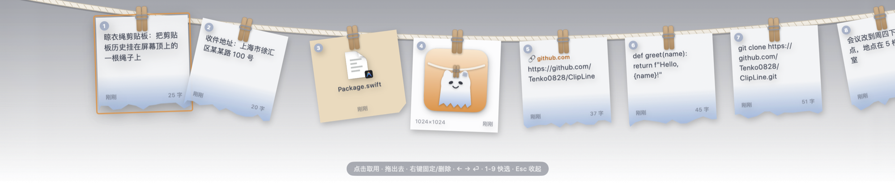

# 晾衣绳剪贴板 ClipLine

一个 macOS 剪贴板历史工具。按下快捷键，屏幕顶上就会落下一根绳子，最近复制过的文字、图片、文件都用晾衣夹挂在上面，点一下就能取回来。



## 功能

- 自动记录复制过的**文字、图片、文件**，重复的内容不会挂两次
- **⌥⌘V** 随时呼出，再按一次或按 Esc 收起；也可以点菜单栏的小幽灵图标
- 点卡片取用：内容写回剪贴板，可选自动粘贴到当前 App
- 卡片可以直接**拖进**其他 App
- 右键卡片可以**固定**（夹子变成橙色，固定的排在最左边、不会被挤掉）或删除
- 右键卡片 →「加工…」：清理空白、合并成一行、JSON 格式化/压缩、提取链接、URL/Base64 编解码；图片可**识别文字（OCR）**；文件可复制完整路径/文件名。结果会作为新卡片挂上绳子并写进剪贴板，只显示对当前内容有意义的动作
- 键盘操作：← → 选择，⏎ 取用，1–9 直接取第几张，Delete 删除
- 东西多的时候用滚轮或触控板左右滑动绳子
- 最多保留 60 条未固定的记录；密码管理器复制的内容（带 `ConcealedType` 标记）不会被记录
- 支持开机自启动，菜单栏右键里可以开关

## 安装

需要 macOS 13 及以上，以及 Xcode 或 Command Line Tools（`xcode-select --install`）。

```bash
git clone https://github.com/Tenko0828/ClipLine.git
```

```bash
cd ClipLine && ./build.sh install
```

`./build.sh install` 会编译、打包成 `ClipLine.app`，装进「应用程序」并注册为开机启动项。只想打包不安装的话，运行 `./build.sh`，产物在 `build/ClipLine.app`。

App 使用本地临时签名（ad-hoc），只适合在自己的电脑上编译使用。

## 权限

- **全局快捷键**和**读取剪贴板**都不需要额外授权。
- **取用后自动粘贴**（菜单栏右键开启）需要在「系统设置 → 隐私与安全性 → 辅助功能」里允许 ClipLine，因为它要模拟按下 ⌘V。每次重新编译后签名会变，需要重新授权一次。

## 数据存放

历史记录保存在 `~/Library/Application Support/ClipLine/`：`history.json` 是索引，`images/` 里是图片原文件。所有数据只存在本机，不会上传到任何地方。菜单栏右键「打开存储文件夹」可以直接打开。

## 代码结构

| 文件 | 内容 |
| --- | --- |
| `Sources/ClipLine/ClipboardStore.swift` | 轮询剪贴板、去重、持久化、写回剪贴板 |
| `Sources/ClipLine/Transforms.swift` | 「加工」动作：文字转换、图片 OCR、文件路径 |
| `Sources/ClipLine/LineController.swift` | 顶部浮窗的显示/收起、滚动、键盘操作、自动粘贴 |
| `Sources/ClipLine/LineView.swift` | 绳子、卡片、空状态等 SwiftUI 界面 |
| `Sources/ClipLine/Theme.swift` | 配色和各种形状（白布便签、晾衣夹、幽灵） |
| `Sources/ClipLine/main.swift` | 菜单栏图标、全局快捷键、开机启动、App 图标渲染 |

## 许可证

[MIT](LICENSE)

## 待办

- [ ] 窗口 / 会话暂存：把当前打开的一组 App 和文件夹存成「场景」，点一下恢复
- [ ] 文本片段库（固定的常用文字）
- [ ] 截图暂存架
